# Deployment and Integration Report

**Project:** Brew & Bloom — Coffee Shop POS
**Repository:** <https://github.com/thabolebata894-ux/brew-bloom-coffee-shop>
**Date:** 13 November 2026
**Scope of this report:** connecting the deployed React frontend to the deployed Express/Redis backend, and proving the connection works end to end.

---

## 0. Submission links

| Item | Link |
| --- | --- |
| Frontend — **submit this one** | https://frontend-thabolebata894-1162s-projects.vercel.app |
| Frontend — short alias (same build) | https://frontend-ten-alpha-29.vercel.app |
| Backend API | https://brew-bloom-backend.onrender.com |
| Backend health check | https://brew-bloom-backend.onrender.com/api/health |
| Source code | https://github.com/thabolebata894-ux/brew-bloom-coffee-shop (private repository) |

> **Do not use `frontend-gbg4vs40w-…vercel.app`.** That is an older, frozen deployment that was built before the API address was configured; it can never reach the backend. Every `frontend-<hash>-…vercel.app` address is a snapshot of a single build, so only the two links above should be used for marking.

All checks below were repeated against the live deployment on 13 November 2026 and passed.

---

## 1. Deployed system

| Component | Platform | URL | Status |
| --- | --- | --- | --- |
| Frontend (React + Vite) | Vercel | <https://frontend-thabolebata894-1162s-projects.vercel.app> | Live — **Ready** |
| Backend (Express + Redis) | Render | <https://brew-bloom-backend.onrender.com> | Live — `{"status":"ok","database":"redis"}` |
| Data store | Redis Cloud | `REDIS_URL` secret on Render | Connected |

The frontend and backend are separate deployments. The browser loads the static React bundle from Vercel and every data request (`/api/...`) is sent to the Render API origin.

```
Browser
  │  GET https://frontend-thabolebata894-1162s-projects.vercel.app  → Vercel CDN → React bundle (dist/)
  │  fetch https://brew-bloom-backend.onrender.com/api/*
  ▼
Express API (server.js)  ──▶  Redis Cloud  (menu, orders, tables, daily ticket counter)
```

---

## 2. How the two are connected

| Layer | Setting | Value |
| --- | --- | --- |
| Vercel → build | `VITE_API_URL` (Production **and** Preview) | `https://brew-bloom-backend.onrender.com` |
| Frontend code | `frontend/src/api/api.js` | `import.meta.env.VITE_API_URL`, with a production fallback to the Render origin |
| Local development | `frontend/.env` + Vite proxy | `VITE_API_URL=http://localhost:4000`, `/api` proxied to port 4000 |
| Backend | `app.use(cors())` | `Access-Control-Allow-Origin: *` — allows the Vercel origin |
| Backend port | `process.env.PORT` | Render-assigned port; `4000` locally |
| SPA routing | `frontend/vercel.json` | All non-asset paths rewritten to `/` so `/staff` etc. work on refresh |

**Change made during this work:** `frontend/src/api/api.js` previously used only `import.meta.env.VITE_API_URL || ''`. If a build was made without the variable, requests were sent to the Vercel domain instead of the API and the site returned HTML where JSON was expected. Production builds now fall back to the deployed API origin, so no deployment can ship "unconnected" again.

```js
const PRODUCTION_API_URL = 'https://brew-bloom-backend.onrender.com';
const FALLBACK_API_URL = import.meta.env.PROD ? PRODUCTION_API_URL : '';
const API_URL = (import.meta.env.VITE_API_URL || FALLBACK_API_URL).replace(/\/+$/, '');
```

---

## 3. Verification method

The site was driven with a headless Chrome browser (1440 × 900) against the **production** URL, not a local build:

1. Load the customer page and wait for the menu to arrive from the API.
2. Add items to the cart, open checkout, and place a real dine-in order.
3. Sign in to the staff portal and confirm the order appears on the POS board.
4. Cancel the order from the POS and confirm the table is released.
5. Re-read the same records from the API to confirm what the browser saw is what Redis stored.

No mocks, no local server: every screenshot below is the live deployment.

---

## 4. Screenshots

All screenshots are stored in `screenshots/`.

### 4.1 Customer home page

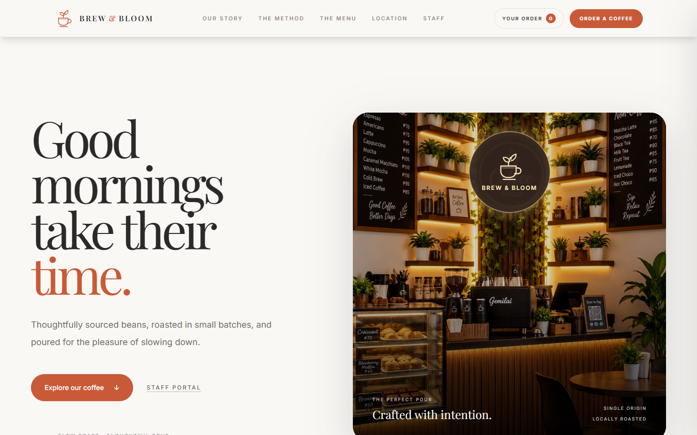

The React bundle is served by Vercel and the page renders with its brand assets.

### 4.2 Menu loaded from the backend API

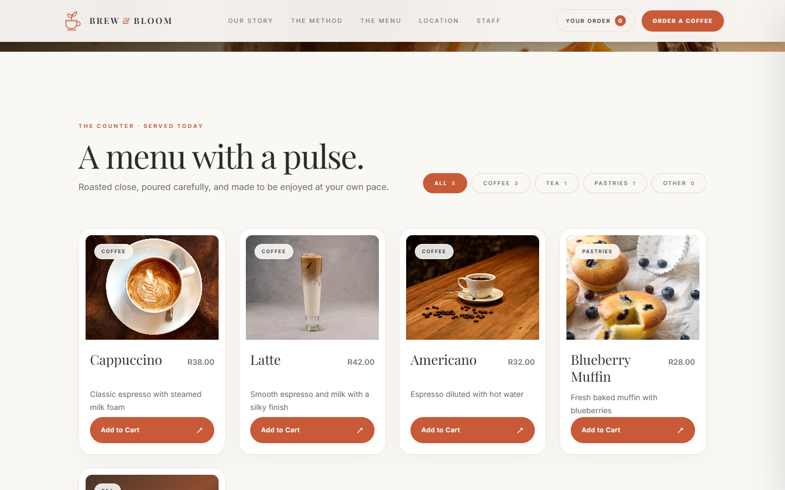

Five menu items returned by `GET /api/menu` — Cappuccino, Latte, Americano, Blueberry Muffin and Black Tea — with live prices in Rand. This is the direct proof that the frontend reaches the backend: the seed data only exists in Redis behind the Render service.

### 4.3 Cart drawer

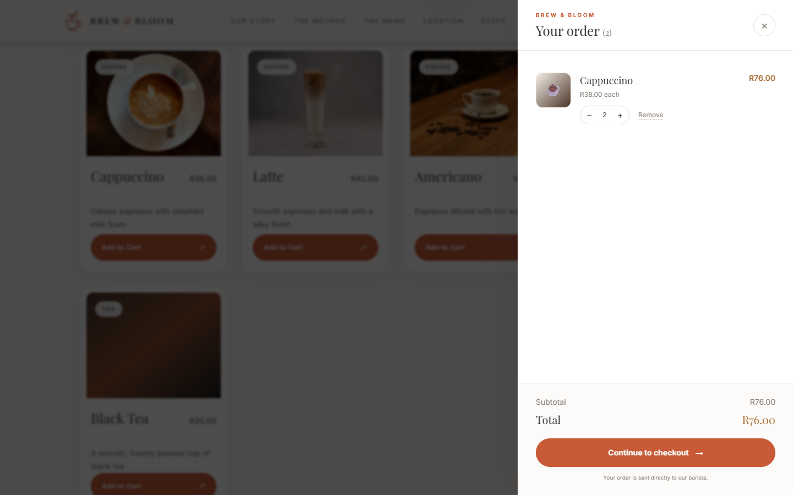

Quantity controls and the running total are calculated client-side from the API-supplied prices.

### 4.4 Checkout (dine-in)

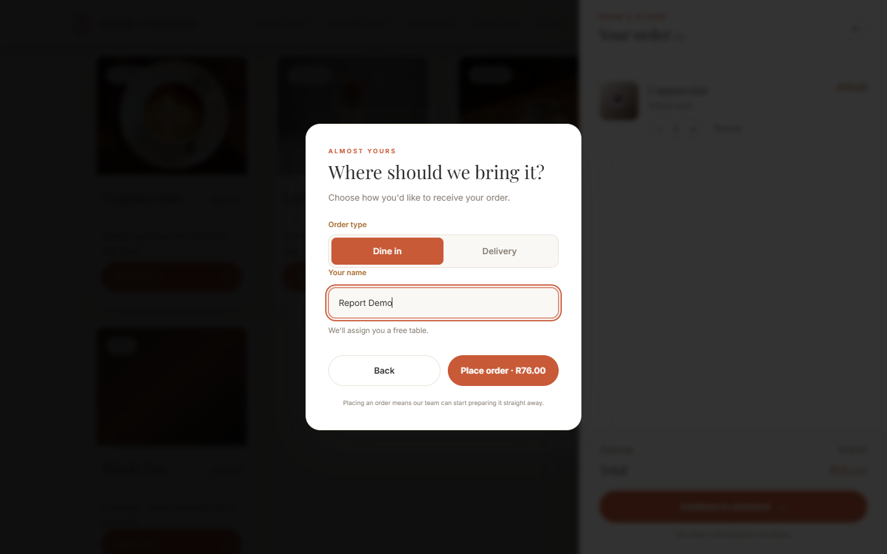

Dine-in orders are posted without a table number; the API assigns the next free table.

### 4.5 Order placed — ticket and table assigned by the API

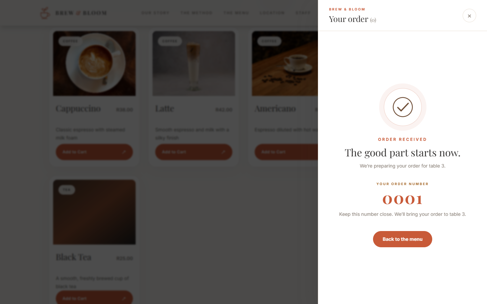

`POST /api/orders` succeeded and returned a server-generated daily ticket number (**0001**) and table (**3**). Both values exist only in Redis, so they cannot be produced by the frontend alone.

### 4.6 Staff login

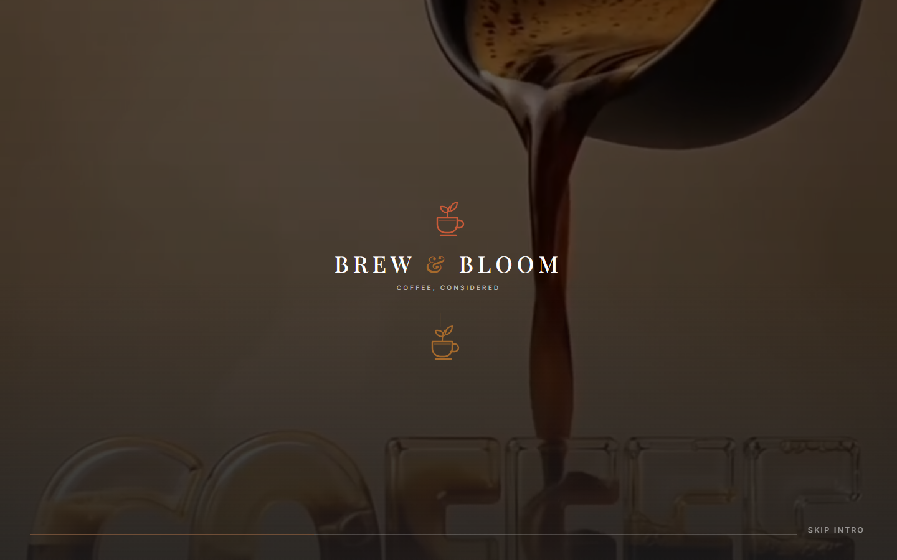

### 4.7 Staff point of sale

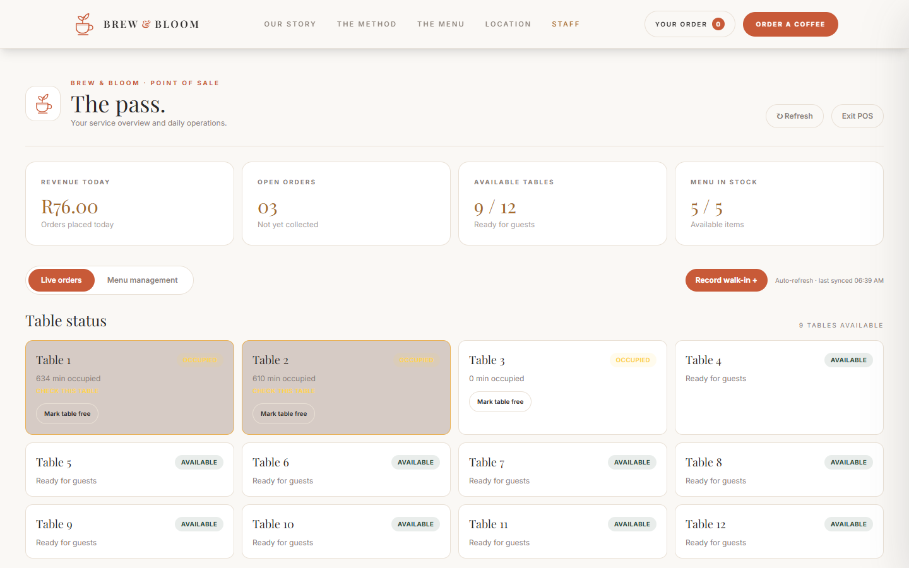
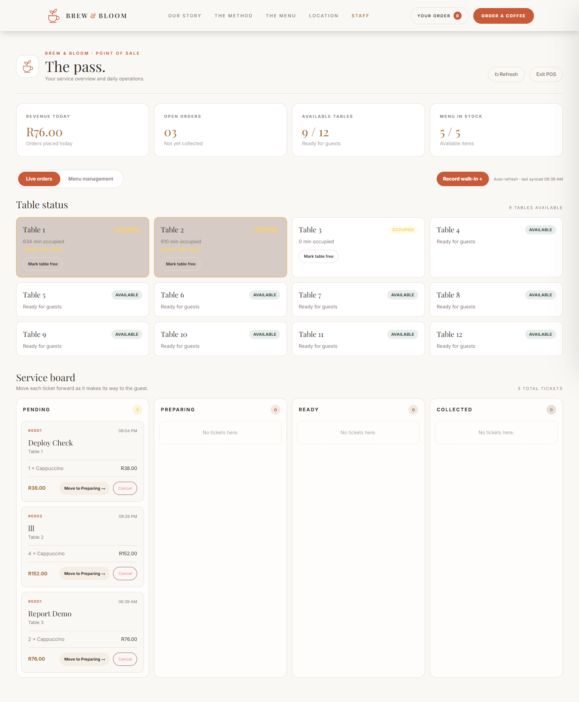

The dashboard loads four endpoints in parallel (`/api/menu`, `/api/orders`, `/api/tables`, `/api/health`) and shows the order placed in section 4.5 on the board, the occupied table, and today's revenue.

### 4.8 Backend endpoints

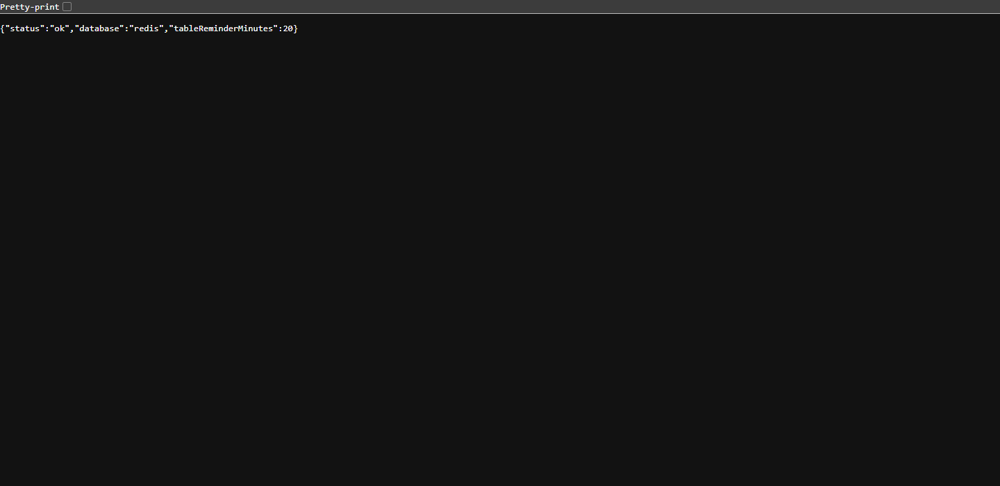
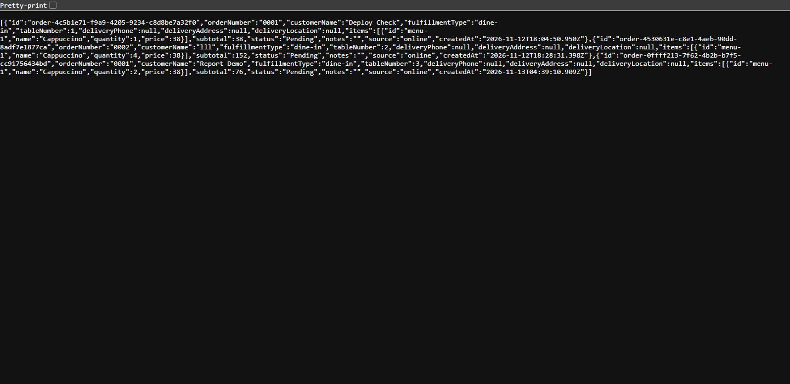

`GET /api/health` returns `{"status":"ok","database":"redis","tableReminderMinutes":20}` and `GET /api/orders` returns the stored order including the calculated subtotal.

### 4.9 Order cancelled and table released

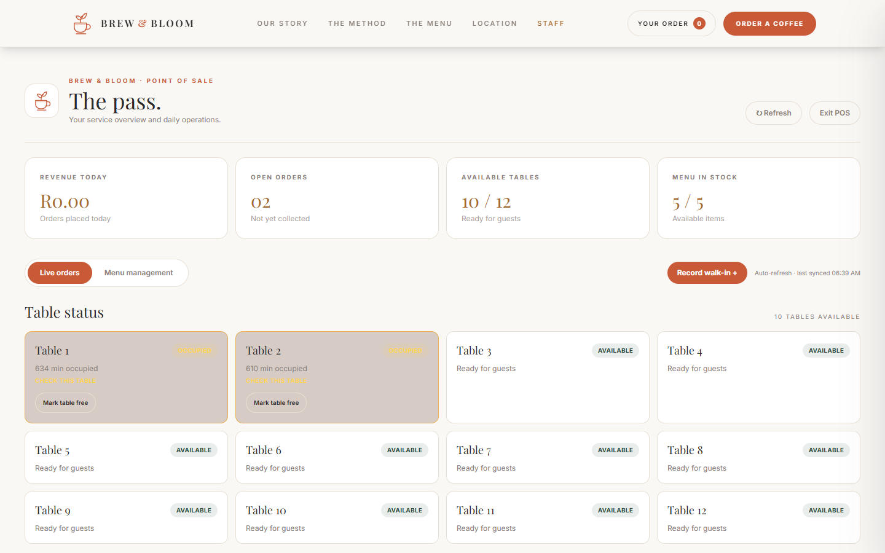

`PATCH /api/orders/:id/cancel` set the order to `Cancelled` and `PATCH /api/tables/3/release` behaviour returned table 3 to the available pool.

---

## 5. Test results

| Check | Expected | Observed | Result |
| --- | --- | --- | --- |
| Frontend reachable | 200 HTML | 200, title "Brew & Bloom — Coffee House" | Pass |
| API origin in built bundle | Render URL | `https://brew-bloom-backend.onrender.com` | Pass |
| `GET /api/health` | `ok` + Redis | `{"status":"ok","database":"redis","tableReminderMinutes":20}` | Pass |
| `GET /api/menu` from browser | 5 items | 5 items rendered | Pass |
| CORS preflight for `POST /api/orders` | 204 + allow origin | `204`, `Access-Control-Allow-Origin: *`, `GET,HEAD,PUT,PATCH,POST,DELETE` | Pass |
| Place order through the UI | 201 + ticket | Order `0001`, table `3`, subtotal `R76.00` | Pass |
| Order visible in POS | Appears on board | Displayed in staff dashboard | Pass |
| Cancel order from POS | Status `Cancelled` | `status: "Cancelled"`, `cancelledAt` set | Pass |
| Table released after cancel | Available | Table 3 `available`, `orderId: null` | Pass |
| SPA deep links (`/staff`, `/menu`) | 200 | 200 | Pass |
| Browser console / network errors | None | None during the flow | Pass |

Result: **the frontend and backend are connected and working end to end.**

---

## 6. Issues found and resolved

1. **Stale deployment looked "disconnected".**
   The deployment URL `frontend-gbg4vs40w-…vercel.app` was built before `VITE_API_URL` existed. Its bundle had no API origin, so `/api/menu` was answered by Vercel's SPA rewrite with `index.html` (HTTP 200, `text/html`), and the UI reported that it could not load the menu. That URL is immutable; the supported entry point is the alias <https://frontend-ten-alpha-29.vercel.app>.

2. **No API URL in Preview builds.**
   `VITE_API_URL` existed only for Production. It is now set for **Preview** as well, so branch/preview deployments also reach the API.

3. **Deployments from the local repo were blocked.**
   Vercel reported: *"The deployment was blocked because the commit author doesn't have permission to create deployments for this project."* The local git author is the placeholder `YOUR-thabolebata89@gmail.com`, which is not the Vercel account (`thabolebata894@gmail.com`). The release was published from a clean copy; to deploy straight from the repo, set the real address once:

   ```
   git config --global user.email "thabolebata894@gmail.com"
   ```

   and commit again (existing commits keep the old author).

---

## 7. Known limitations

- **Render free tier** idles after inactivity; the first request of the day can take ~50 seconds. The menu shows a retry button if that request times out.
- **Staff login is a demo gate only.** Any non-empty ID and password opens the POS; there is no authentication, session handling or role check.
- **No payment step.** Totals are calculated but no payment provider is integrated.
- **Redis on the free tier** has no persistence guarantee; menu and order history can be lost on a Redis restart.
- Menu item prices are validated server-side (minimum R20.00) but the public API has no write authorisation — `POST/PUT/DELETE /api/menu` are open. This is acceptable for a marking demo, not for production traffic.

---

## 8. Reproducing the verification

```bash
# 1. Backend health
curl https://brew-bloom-backend.onrender.com/api/health

# 2. Menu served to the frontend
curl https://brew-bloom-backend.onrender.com/api/menu

# 3. CORS for the deployed frontend origin
curl -i -X OPTIONS https://brew-bloom-backend.onrender.com/api/orders \
  -H "Origin: https://frontend-thabolebata894-1162s-projects.vercel.app" \
  -H "Access-Control-Request-Method: POST" \
  -H "Access-Control-Request-Headers: content-type"

# 4. Frontend build configuration
vercel env ls --cwd frontend
```

To redeploy the frontend after a change:

```bash
cd frontend
vercel --prod
```

`VITE_API_URL` is already configured in the Vercel project, so no additional environment setup is required.
